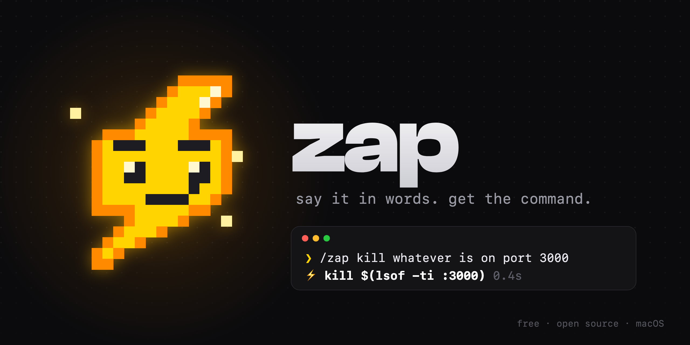
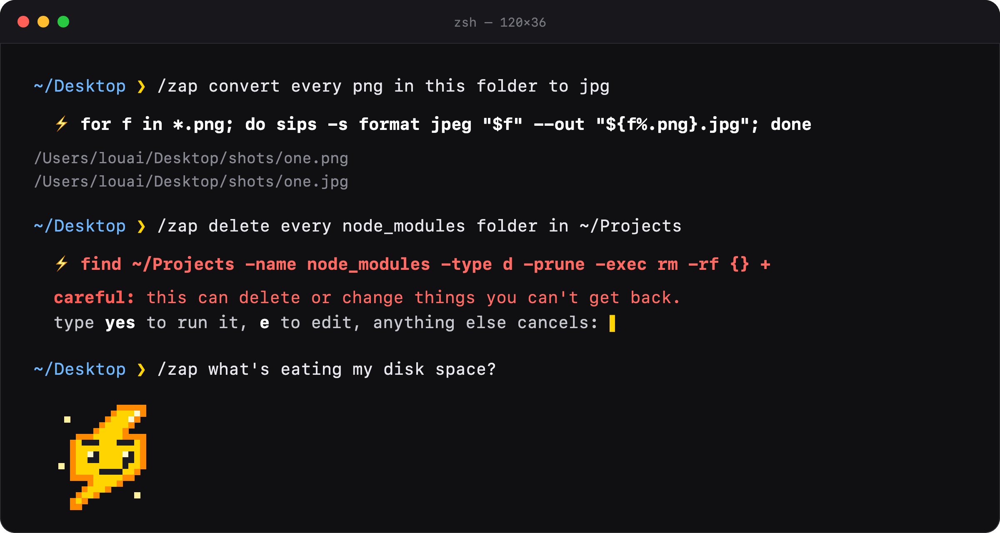

<p align="center">
  
</p>

<p align="center">
  
  
  
  
  
</p>

<p align="center">
  <b>Stop googling terminal commands.</b><br>
  Type what you want in plain words, Zap turns it into the right command for your Mac, and you hit <code>y</code>.
</p>

<p align="center">
  <a href="#install">Install</a> ·
  <a href="#how-you-use-it">How you use it</a> ·
  <a href="#pick-a-brain">Pick a brain</a> ·
  <a href="#meet-flash">Meet Flash</a> ·
  <a href="#faq">FAQ</a>
</p>

<br>

<p align="center">
  
</p>

## Why I made this

Every week I'd end up googling the same things. How do I find big files again? What's the `ffmpeg` flag for that? Why does `sed -i` break on a Mac? Which process is sitting on port 3000?

The answer is always one line, but finding it takes five minutes and three Stack Overflow tabs. So I made Zap: you describe the thing, it writes the line, you look at it, and it runs. It works with the AI you already have, it's free, and the fast option answers before you've let go of Enter.

## What it does

|  |  |
|---|---|
| ⚡ **Fast** | With Groq or Cerebras the command is back in about half a second. |
| 👀 **Shows before it runs** | You always see the command first. `y` runs it, `e` edits it, anything else cancels. |
| 🛑 **Careful with risky stuff** | `rm`, `sudo`, `dd`, `git push --force` and friends show up red, and you have to type `yes` in full. |
| 🔁 **Fixes its own mistakes** | If a command fails, Zap sends the error back and gets you a fixed version. |
| 📁 **Knows where you are** | It sees your current folder and the tools you have installed, so it won't reach for `ffmpeg` if you don't have it. |
| 🍎 **Speaks Mac** | BSD `sed`, `stat -f`, `open -a`, `osascript`. It writes commands that actually work on macOS. |
| ⬆️ **Remembers** | The real command goes into your shell history, so the up arrow brings it back next time. |
| 🧭 **Real `cd`** | Zap runs inside your shell, so `/zap take me to my downloads` actually takes you there. |

## Install

1. Download **`Zap.dmg`** from [Releases](../../releases) and drag Zap into Applications.
2. Open it. The first time, macOS blocks apps that aren't from the App Store: go to **System Settings → Privacy & Security** and click **Open Anyway**.
3. Pick a brain and a model, then click **Connect**.
4. Open a new Terminal window and type `/zap` followed by whatever you want.

<details>
<summary><b>Install without the app</b></summary>

```sh
git clone https://github.com/Louai-Ulaval/zap.git
cd zap
./scripts/install.sh --provider groq
echo 'GROQ_API_KEY=your-key-here' >> ~/.zap/keys && chmod 600 ~/.zap/keys
```

</details>

## How you use it

```
/zap convert every png in this folder to jpg
/zap what's using port 3000? kill it
/zap make a folder for each month of 2026
/zap zip this folder without node_modules
/zap open spotify
/zap how much space is left on my disk
```

No quotes needed. Apostrophes, question marks, whatever: just type like you'd text someone.

Don't want to press `y` every time? Turn on **Run safe commands right away** in the app, or run `zap --auto on`. Safe commands then run straight away. Risky ones still stop and ask.

```
zap                                 say hi to Flash, see the help
zap --use groq openai/gpt-oss-20b   switch brain or model
zap --auto on|off                   run safe commands without asking
zap --history                       what you ran lately
```

## Pick a brain

Zap doesn't come with its own AI. It uses one you already have, or a free one you can get in a minute.

| Brain | Speed | Cost | What you need |
|---|---|---|---|
| **Groq** ⭐ | ~0.5 s | free | a free key from [console.groq.com/keys](https://console.groq.com/keys) |
| **Cerebras** | ~0.5 s | free | a free key from [cloud.cerebras.ai](https://cloud.cerebras.ai) |
| **Claude Code** | ~4 s | your Claude plan | [Claude Code](https://docs.anthropic.com/en/docs/claude-code/setup) installed. Zap signs you in if needed |
| **Ollama** | ~2 s | free, offline | [Ollama](https://ollama.com/download) and any model |
| **Codex** | slower | your ChatGPT plan | [Codex CLI](https://github.com/openai/codex) |
| **Gemini CLI** | slower | free | [Gemini CLI](https://github.com/google-gemini/gemini-cli) |

Every brain has a model menu in the app. For Groq and Cerebras the list comes live from their API, so new models show up on their own. Keys stay on your Mac in `~/.zap/keys`, readable only by you.

## Meet Flash


Flash is the little bolt who lives in your terminal. While the AI is working, he crackles, blinks and winks right under your prompt. The moment your command is ready, he's gone.

He's drawn with nothing but text: every pixel is a coloured half block (`▀`), two pixels per character row, 256 colours, so he works in the stock macOS Terminal with no images or plugins. Type `zap` on its own to say hi.

<br clear="right">

## FAQ

<details>
<summary><b>Is it safe?</b></summary>
<br>
Nothing runs until you've seen it. With auto-run on, only commands Zap considers safe run straight away. Anything that deletes, uses <code>sudo</code>, force-pushes, wipes disks or pipes a download into a shell always stops and asks you to type <code>yes</code>. Still, read what you run.
</details>

<details>
<summary><b>What gets sent to the AI?</b></summary>
<br>
Your request, your current folder path, up to 40 file names from that folder, your macOS version, and which common tools you have installed. Nothing else. With Ollama, nothing leaves your Mac at all.
</details>

<details>
<summary><b>Why <code>/zap</code> with a slash?</b></summary>
<br>
It feels like a slash command in a chat app, and it lets Zap grab the whole line before zsh tries to read it. That's why apostrophes and <code>?</code> just work. Plain <code>zap</code> works too.
</details>

<details>
<summary><b>Bash? fish?</b></summary>
<br>
zsh only for now. It's been the default shell on macOS since Catalina.
</details>

<details>
<summary><b>How do I uninstall it?</b></summary>
<br>
Open Zap and click <b>Uninstall</b>, or run <code>./scripts/install.sh --uninstall</code>. It removes <code>~/.zap</code> and the two lines it added to <code>~/.zshrc</code>.
</details>

## Build it yourself

You need the Xcode command line tools (`xcode-select --install`).

```sh
./scripts/build-dmg.sh      # → build/Zap.app and build/Zap-<version>.dmg (Apple Silicon + Intel)
```

```
shell/zap.zsh            everything that happens in Terminal, Flash included
app/ZapSetup.swift       the setup window
scripts/install.sh       installs zap into ~/.zap and hooks it into ~/.zshrc
scripts/build-dmg.sh     builds the app and the dmg
scripts/render-flash.py  turns Flash's pixel rows into the PNGs and GIF
scripts/make-art.py      makes the banner and demo images
```

`/zap` works by hooking the Enter key: a line that starts with `/zap` gets quoted and handed to the `zap` function before zsh ever parses it.

## License

MIT. Do whatever you like with it.

<p align="center"><br><br><sub>made on a Mac, for Macs</sub></p>
